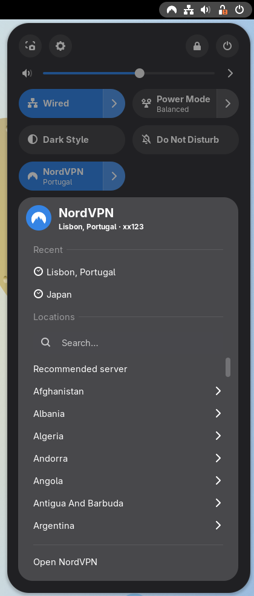
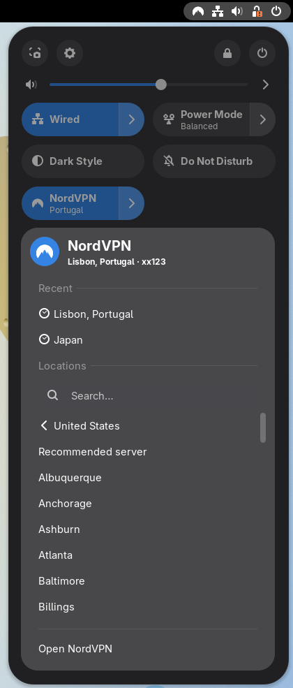

# NordVPN Toggle

A NordVPN toggle for the GNOME Shell Quick Settings menu. Click it to connect or disconnect; its menu
lists your recent locations and every country and city, with a search field, plus a shortcut to the
NordVPN app for everything else (login, kill switch, Meshnet, settings).

| Connected | Choosing a city |
| :---: | :---: |
|  |  |

For GNOME Shell 51. Requires the [NordVPN app for Linux](https://nordvpn.com/download/linux/) (the
`nordvpn` command and the `nordvpnd` service). Not affiliated with NordVPN.

## What it does

- **The toggle** connects to the last location you used (the recommended server the first time) and
  disconnects. While connected it shows the country, and a NordVPN icon appears in the top bar.
- **The menu** (the arrow next to the toggle) has:
  - **Recent**: the last four locations you connected to;
  - **Locations**: the recommended server and every country; open a country to pick one of its cities or
    its recommended server. The search field filters the list, and Enter picks the first match;
  - **Open NordVPN**: opens the NordVPN app, shown when it is installed.
- **It follows the real state**, including connections made from the terminal or the NordVPN app, and shows
  *Connecting…*, *Not logged in*, *No permission* or *Service not running* when that is the case, with a
  notification explaining what to do.

## Install

With one command that downloads the latest [release](https://github.com/Ticko4/gnome-nordvpn-toggle/releases),
installs it and turns it on (GNOME Shell 51; nothing to build):

```bash
curl -fsSL https://raw.githubusercontent.com/Ticko4/gnome-nordvpn-toggle/main/get.sh | bash
```

Then log out and back in. Running it again updates to the newest release. From source:

```bash
git clone https://github.com/Ticko4/gnome-nordvpn-toggle.git
cd gnome-nordvpn-toggle
./install.sh
```

The script installs the extension in `~/.local/share/gnome-shell/extensions` and enables it. On Wayland,
log out and back in for it to appear. `./install.sh --pack` builds the zip for extensions.gnome.org;
GitHub releases attach the same zip as `nordvpn-toggle.zip`, which `get.sh` downloads.

### Before the first use

- Add your user to the `nordvpn` group, then log out and back in:

  ```bash
  sudo usermod -aG nordvpn $USER
  ```

- Log in to NordVPN once, with the NordVPN app or `nordvpn login`.

## How it works

- Everything goes through the `nordvpn` command (`status`, `countries`, `cities`, `connect`,
  `disconnect`), run asynchronously so the shell never waits on it. The extension does not talk to
  NordVPN's servers itself.
- The state is read when the extension starts, when Quick Settings opens, when the network changes, every
  1.5 s while connecting and every 30 s otherwise.
- Countries are read the first time the menu opens and cities the first time a country is opened; both are
  kept for the session.
- Recent locations are stored in `~/.local/state/nordvpn-toggle/recent.json`.

Errors go to the GNOME Shell log: `journalctl -f -o cat /usr/bin/gnome-shell`.

## Layout

```
nordvpn-toggle@ticko4.github.io/
├── extension.js      toggle, menu, nordvpn CLI calls
├── stylesheet.css
├── metadata.json
└── icons/            NordVPN symbolic icon
docs/                 screenshots
install.sh            install from source, or --pack
get.sh                install from the latest release
```

## Uninstall

```bash
gnome-extensions uninstall nordvpn-toggle@ticko4.github.io
```

## License

GPL-2.0-or-later. See [LICENSE](LICENSE).

Based on [NordVPN Quick Toggle](https://github.com/Wedaxi/NordVPN-Quick-Toggle) by Wedaxi
(GPL-2.0-or-later), including its NordVPN symbolic icon.
